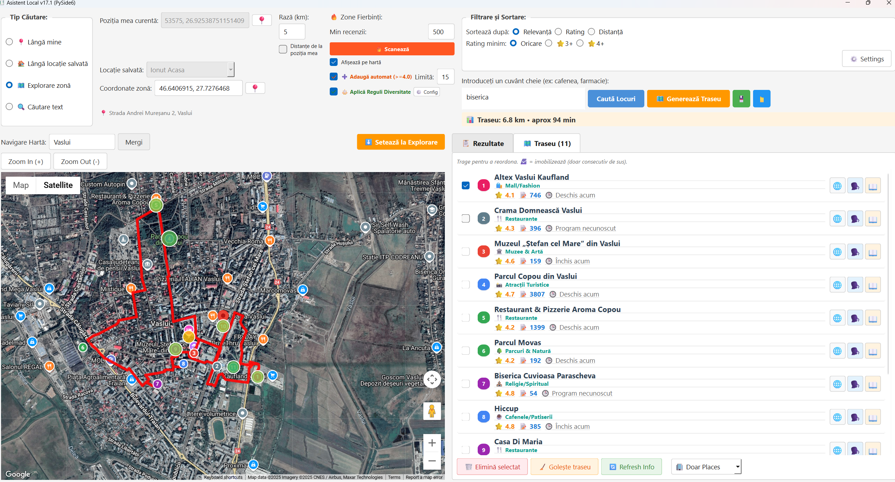

# Turist Pro

Desktop trip planner with Google Maps integration and automatic scanning for points of interest along a route or within a radius.

> The user interface is in Romanian. Button names below are given in Romanian, with the English meaning in brackets.

## 📋 Overview

Turist Pro is a trip-planning application that lets you:
- find and display points of interest on an interactive map
- plan custom routes through multiple destinations
- automatically scan for points of interest along the planned route
- manage your own database of places (imported from Excel)
- export routes to KML for GPS devices and apps



## ✨ Main features

### 🗺️ Interactive map
- Interactive Google Maps view
- 4 map types: Roadmap, Satellite, Hybrid, Terrain
- Add points by clicking on the map or by searching
- Drag & drop to reorder waypoints
- Visual preview of the planned route

### 🎯 Search modes

#### Radial mode (search around a point)
- Configurable radius (10–200 km)
- Multiple keywords per search
- Automatic quality filter (rating ≥ 4.0 for restaurants)
- Sort by distance or rating

#### Linear mode (scan along the route)
- Automatic scanning along the planned route
- Configurable scan interval (5–50 km)
- Configurable allowed deviation from the route (500 m – 10 km)
- KML export with every point found
- Detailed logging to text files

### 📊 Custom data
- Import from Excel (.xlsx)
- Predefined column structure:
  - name, community size, patron saint (hram), type, year
  - GPS coordinates
  - region, archdiocese, metropolis
  - web links
- Unique IDs generated automatically
- Separate visual layer on the map

### 🔍 Filtering and sorting
- Filter by rating (1–5 stars)
- Filter by number of reviews
- Filter by source (custom / Google)
- Sort by distance or popularity
- Search within the results

### 💾 Saved application state
- Recently used routes
- User preferences
- Favourite keywords
- Map position
- Scan settings

## 🛠️ Technologies

- **Python 3.8+**
- **PySide6** (Qt 6): desktop GUI
- **Google Maps Platform**: Maps JavaScript API, Places API, Directions API
- **googlemaps** (Python client for the Google Maps APIs)
- **OpenPyXL**: Excel import
- **python-dotenv**, **requests**

## 📦 Installation

### Requirements
```bash
pip install PySide6 googlemaps openpyxl python-dotenv requests
```

### API key

1. Get an API key from the [Google Cloud Console](https://console.cloud.google.com/).
2. Enable these services:
   - Maps JavaScript API
   - Places API
   - Directions API
3. Create a `.env` file in the application folder:

```env
GOOGLE_MAPS_API_KEY=your_api_key_here
```

### File structure

```
turist_pro_v05/
├── turist_pro_v05.py          # main application
├── custom_data_manager.py     # custom data manager
├── .env                       # API key (never commit it!)
├── map_template.html          # map template
├── Logs/                      # log folder (created automatically)
└── date_custom.xlsx           # (optional) custom data file
```

## 🚀 Usage

### Start the application
```bash
python turist_pro_v05.py
```

### 1. Set the starting point
- **Option 1:** click on the map
- **Option 2:** search in the text field at the top
- **Option 3:** the "📍 Locație Curentă" button (current location, via IP geolocation)

### 2. Radial search

1. Set the search radius (slider, 10–200 km).
2. Enter keywords (e.g. "biserică" = church, "mănăstire" = monastery, "muzeu" = museum).
3. Click "🔍 Căutare Radială" (radial search).
4. Review the results in the "Rezultate" (results) tab.

### 3. Route planning

1. Add waypoints:
   - click "Adaugă Waypoint" (add waypoint) and search for the place,
   - or click directly on the map while waypoint mode is active.
2. Reorder them by drag & drop in the list.
3. Remove unwanted points with the "🗑️" button.
4. Click "🎯 Calculează Rută" (calculate route) for a preview.
5. Click "🚀 SCANARE LINIARĂ" (linear scan) to search along the route.

### 4. Linear scan (advanced)

Parameters:
- **Scan interval:** distance between search points (5–50 km)
- **Google deviation:** how far from the route to search Google Places (500 m – 10 km)
- **Custom deviation:** how far from the route to include custom places (0.5–20 km)

After the scan:
- results appear in the "Rezultate" tab
- a detailed log file is written to `Logs/`
- the "💾 EXPORT KML" button becomes active
- every point is marked on the map

### 5. KML export

After a linear scan:
1. Click "💾 EXPORT KML".
2. Choose the folder and file name.
3. The file contains:
   - the full route
   - all waypoints
   - all places found
   - details for each place (rating, number of reviews, types)

## 📋 Custom data Excel format

### Required structure

The column headers stay in Romanian, because the application reads them that way.

| Column | Index | Header | Meaning | Format | Example |
|--------|-------|--------|---------|--------|---------|
| C | 2 | Nume | name | text | "Biserica Sf. Nicolae" |
| D | 3 | Viețuitori | community size | number | "5000" |
| E | 4 | Hram | patron saint | text | "Sf. Nicolae" |
| F | 5 | Tip | type | text | "Biserică" |
| G | 6 | An | year | number/text | "1850" |
| H | 7 | Coordonate | coordinates | "lat,lng" | "47.1585, 27.6014" |
| I | 8 | Regiune | region | text | "Moldova" |
| J | 9 | Arhiepiscopie | archdiocese | text | "Iași" |
| K | 10 | Mitropolie | metropolis | text | "Moldovei" |

### Rules
- The first row is the header and is skipped.
- Coordinates can be separated by `,` or `;`.
- Empty cells are filled automatically with "-".
- Web links: put a hyperlink on the cell in column C (name).
- Unique IDs are generated from name + coordinates.

### Example of a valid row
```
C: Biserica Vovidenia (with a hyperlink to its website)
D: 3500
E: Sf. Maria
F: Biserică
G: 1803
H: 47.1585, 27.6014
I: Moldova
J: Iași
K: Moldovei și Bucovinei
```

## ⚙️ Advanced settings

### Quality filters
- Restaurants / cafés / bars: minimum rating 4.0, applied automatically
- Other categories: no rating filter
- Filtering by number of reviews is available in the UI

### Scan parameters
```python
# Maximum distance for "nearby" in radial mode
MAX_RADIAL_SEARCH = 200_000  # metres

# Default interval between scan points
DEFAULT_SCAN_STEP = 20  # km

# Default deviation from the route
DEFAULT_DEVIATION_GOOGLE = 3000  # metres
DEFAULT_DEVIATION_CUSTOM = 5000  # metres
```

## 📁 Logs

A log file is written automatically for every scan:

```
Logs/
└── scan_2025-01-28_143522.txt
```

### Log contents
- timestamp for every action
- scan parameters used
- number of scan points
- a detailed table for each candidate:
  - name (max. 32 characters)
  - rating
  - number of votes
  - deviation from the route
  - status (accepted / skipped)
- final statistics

### Sample log (the log text is in Romanian)
```
[14:35:25] [INFO] 📍 Puncte de scanare (Pioneze): 8
[14:35:26] [DATA] 📍 PUNCT SCANARE 1/8 ((47.158, 27.601))
[14:35:26] [DATA]    🔎 Keyword 'restaurant': 12 candidați brut.
[14:35:26] [DATA]       NUME                             | RAT. | VOTURI | ABATERE    | STATUS
[14:35:26] [DATA]       ------------------------------------------------------------------------------------------
[14:35:26] [DATA]       Restaurant Panoramic            | 4.5  | 324    | 1250m      | ✅ ACCEPTAT
[14:35:26] [DATA]       Bistro La Castel               | 3.8  | 89     | 890m       | ❌ SKIP CALITATE (3.8<4.0)
```

## 🔧 Development

### Building the executable (.exe)

```bash
pip install pyinstaller

pyinstaller --onefile --windowed \
    --add-data "map_template.html;." \
    --add-data ".env;." \
    --icon=icon.ico \
    --name="TuristPro" \
    turist_pro_v05.py
```

### Main helper functions

```python
# Distance between two coordinates
haversine_distance(lat1, lon1, lat2, lon2) -> float

# Decode a Google polyline
decode_polyline(polyline_str) -> List[Tuple[float, float]]

# Distance from a point to a line segment
point_line_distance(point, start, end) -> float
```

## 🐛 Troubleshooting

### "Invalid API Key"
- Check the `.env` file.
- Make sure the APIs are enabled in the Google Cloud Console.
- Check the key restrictions (IP, referrer).

### The map does not load
- Check your internet connection.
- Check the JavaScript console (Debug menu).
- Regenerate the map (menu → Regenerare Hartă).

### Custom data does not appear
- Check the Excel structure (correct columns).
- Check the coordinate format (lat,lng).
- Check the logs for import errors.

### Linear scan is slow
- Use fewer keywords.
- Increase the scan interval.
- Reduce the search radius.

## 📝 Changelog

### v0.5 (current)
- ✅ Logging to console and file
- ✅ Detailed table for every scan candidate
- ✅ Working KML export
- ✅ Custom data manager with 3 new columns
- ✅ Automatic quality filtering
- ✅ Improved UI with tabs and icons
- ✅ Saving and restoring the application state

## 📄 License

Private project. All rights reserved.

## 👨‍💻 Author

**Mihai Mereu** ([github.com/mmereu97](https://github.com/mmereu97)). Built to plan tourist routes and discover points of interest across Romania, including its monasteries and churches.

---

**Version:** 0.5 · **Date:** November 2024
